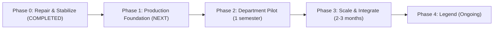

# XephyGuard Roadmap: From Zero to Legend

This roadmap tracks XephyGuard's progression from a research and lab prototype to a production-grade, ethically defensible academic-integrity platform for universities and colleges worldwide. Every deliverable is governed by the [Integrity Charter](CHARTER.md) and the [Privacy and Ethics Statement](ETHICS.md).

---

## 1. Five-Phase Roadmap & Exit Criteria

| Phase | Status | Goal | Key Deliverables | Exit Criteria |
|---|---|---|---|---|
| **0. Repair & Stabilize** | **Completed** | Remediate ethics and security regressions (`R1`–`R12`), lock interface contracts, and restore trust in the codebase | • Remove synthetic `window_focus` events; introduce truthful `ide_ai_activity` with confidence and meaning (`R1`, `R2`) • Enforce the [`ETHICS.md`](ETHICS.md) tiered collection table in both `PolicyBuilder` and the C++ agent (`R3`, `R4`) • Suppress `Always-on` popups, deduplicate installed-only inventory, and restrict process kills to active `Test` sessions (`R5`, `R6`, `R7`) • Remove agent-side DNS cache inspection and `ipconfig /flushdns` (`R8`) • Restore TLS hostname/SAN verification alongside fingerprint pinning (`R9`) • Remove hardcoded enrollment keys and CA fingerprints from the Windows installer (`R10`) • Implement lease-backed network isolation (`isolation_lease_s`) with exact route save/restore (`R11`) and gate `/downloads` behind authentication/ACL (`R12`) • Convert direct DB edits into migrations/seeders and add the ethics-contract CI test • Publish [`CHARTER.md`](CHARTER.md), updated [`ETHICS.md`](ETHICS.md), [`THREAT_MODEL.md`](THREAT_MODEL.md), [`DECISIONS.md`](DECISIONS.md), `LICENSE` (AGPL-3.0), and `SECURITY.md` | • [`ETHICS.md`](ETHICS.md) tiered collection table matches runtime behavior in both server and agent (verified by automated tests) • Zero synthetic events in the agent • TLS hostname verification and fingerprint pinning enforced and tested • Zero secrets embedded in installer scripts or build artifacts • Isolation lease restores saved routes automatically on expiry or restart |
| **1. Production Foundation** | Planned *(4–6 weeks)* | Deliver a hardened, reproducible release ready for university deployment on both Linux/Docker and Windows CCC platforms | • First-class CCC deployment support on both **Linux + Docker Compose** (primary gateway stack) and **Windows** (service-wrapped production support) • Separate CA roles (Agent-mTLS CA, signature-signing key, and name-constrained mitmproxy interception CA) • Authenticode-signed Windows binaries and GPG-signed Linux `.deb` packages with CycloneDX SBOM and reproducible release builds (no debug/release CRT mix) • Short-lived, per-lab revocable enrollment keys • Full separation of *installed* vs. *active* vs. *blocked* events in UI and scoring • Bilingual student-facing UI and notices (**Bangla and English**) • Automated MySQL 8 backups with verified restore, `/healthz`, and Prometheus metrics | • Clean CCC + lab PC installation completed in under 1 hour by a lab assistant following documentation • Red-team evaluation suite passes in `Test` mode • Zero false-positive browser/process kills across 20 honest test sessions • Agent core test coverage ≥ 80%, server service test coverage ≥ 85% |
| **2. Department Pilot** | Planned *(1 semester)* | Validate detection accuracy, operational reliability, and student trust in a real university department under IRB/ethics approval | • Institutional ethics board (IRB/REC) approval and one-click DPIA / ethics-review pack generator • Student transparency portal (students sign in to view their own sessions, flags, and raw signals, download their data, and submit responses) • End-to-end appeals workflow (Flag → Instructor review → Student response → Audited decision) tracking overturn rates • Configuration-driven `/notice` and tray tooltips so student notices always match the active profile • Instructor session wizard with pre-flight health checks and calm live seat map • Scheduled retention purge with auditable proof and legal-hold support for open appeals | • High-severity false-positive rate < 2% on honest student sessions • Zero stuck network isolations or lost student work incidents • All overturned flags documented and used to refine detection rules • Post-session student trust survey completed ("I understand what is monitored" ≥ 80% agree) |
| **3. Scale & Integrate** | Planned *(2–3 months)* | Scale to campus-wide multi-lab operations with institutional identity and LMS integration | • Institutional SSO (SAML 2.0, OIDC, LDAP) and MFA for administrators • **Moodle integration via LTI 1.3** for automatic rosters and exam timetables (with CSV fallback) • Multi-lab and multi-campus tenancy with delegated department administrators • Configurable two-person rule for isolation, process termination, exemption changes, and research exports • Staged agent fleet rollout (5% canary → 100%) with per-lab version pinning and one-click rollback • Signed community signature feed with diff review before activation • Independent external penetration test | • 1,000 concurrent lab PCs supported on a single CCC with < 1 s alert latency • All high/medium findings from the external penetration test remediated and verified • Production deployment across 2+ departments or partner institutions |
| **4. Legend** | Planned *(Ongoing)* | Define the ethical academic-integrity category through pedagogical AI modes, fairness audits, and open research | • **AI-permitted with disclosure** assessment mode (opt-in per instructor): institution-run AI gateway via the CCC proxy with shared transparent logging for students and instructors • Optional, student-consented **process-evidence work journal** (save timestamps and size progression) to demonstrate authentic authorship • Aggregate, anonymized course-design analytics for instructors • Formal fairness audit measuring false-positive rates across typing styles, non-native typists, and students with accommodations • Accessibility certification (**WCAG 2.2 AA**) and peer-reviewed publication of pilot and red-team datasets | • Peer-reviewed study and fairness audit published openly • Independent security and privacy audit completed • Adoption by external universities and community contributions to the open signature standard |

---

## 2. Success Metrics & Operational Targets

| Metric | Target | Verification Method |
|---|---|---|
| **False-positive rate on honest sessions** | `< 2%` of sessions raising a high-severity flag | Labeled honest lab sessions and pilot overturn tracking |
| **Red-team bypass rate (`Test` mode, gateway active)** | `< 10%` of scenarios undetected; residual risks documented in [`THREAT_MODEL.md`](THREAT_MODEL.md) | Automated `eval/` red-team harness across `eval/scenarios/*.yaml` |
| **Time to detect a strong signal** | `< 5 seconds` from event occurrence to CCC dashboard alert | Load simulator and live check benchmarks |
| **Stuck isolations / lost student work** | `0` incidents | Lease-expiry telemetry (`isolation_lease_expired`), startup recovery logs, and pilot incident reports |
| **Agent resource overhead** | `< 1%` average CPU, `< 30 MB` RSS RAM | Continuous agent health telemetry on Windows and Linux lab PCs |
| **Appeals overturn tracking** | `100%` of appeals audited; rules behind overturned flags reviewed | CCC appeals audit log and semester quality review |
| **Student comprehension & trust** | `≥ 80%` of surveyed students agree *"I understand what is monitored and when"* | Anonymous post-session student survey |
